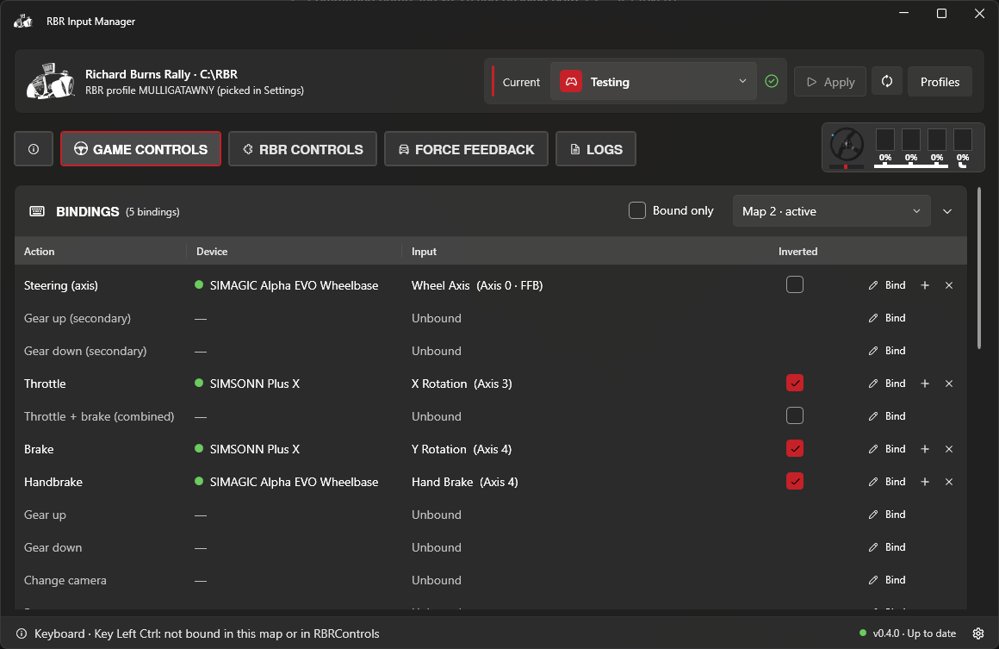

# RBR Input Manager



A Windows app for managing Richard Burns Rally (RallySimFans) input settings: game bindings, force feedback and the RBRControls plugin.

RBR stores controller bindings by DirectInput *instance GUID*. When Windows gives a device a new GUID (different USB port, driver reinstall, new hardware…) the game silently drops its bindings. This app shows what is bound to what, which devices are missing, and lets you keep named profiles of your setup.

## Features

### Game controls
- Every RBR action with its device, input and axis inversion (`SavedGames\pf<PROFILE>.acm`, `input.ini`), plus a green/red status dot for each device. Missing devices show when Windows last saw them; those seen in the last month get an amber dot instead of red.
- **Control maps**: RBR keeps one map per set of connected controllers and creates a fresh default map when that set changes, which is why controls "reset". The app shows every map, marks the active one and can copy an old map into it.
- **Use a map with the connected controllers**: when no map matches the controllers plugged in right now, the app says which ones differ and can rewrite the selected map's device list so RBR uses its bindings instead of a default map.
- **Binding editor**: press **Bind** on an action, then press a button/key or move an axis on any connected device. **+** adds a second binding, **✕** removes one. Each action only accepts what makes sense (steering needs an axis, pedals an axis or a button, the rest buttons and keys), and inputs already in use can be moved or shared.
- **Invert axes** with the checkbox in the Inverted column (steering, throttle, brake, combined, handbrake, clutch).
- **Secondary gear up/down**: with NGPCarMenu's `SecondaryGearUpDownControls` on, the Steer left / Steer right slots are shown and bound as Gear Up / Gear Down (Secondary), like RBR's own control screen.
- **Pending changes**: edits stay pending until **Save to game**, which checks RBR and the RSF launcher are closed, backs up the files, writes them and reads them back to verify. The "N CHANGES" button lists every edit before saving.
- **Find by pressing**: with the app in front, press any input to jump to where it is bound.
- **Live input display** next to the tabs, styled after RBR's input HUD: steering wheel plus clutch, brake, throttle and handbrake bars, following the active map (including unsaved edits).

### RBRControls
- JoyKey and HShifter binds and options (`Plugins\RBRControls\RBRControls.ini`), editable with the same binding editor. Binds on disconnected devices are matched by name against controllers Windows remembers.

### Force feedback
- The in-game strength slider (Options → Controls → Force Feedback → Strength), with a warning when it isn't at 100% and a button to set it, writing a valid, checksummed RBR profile and verifying it.
- Values from `RichardBurnsRally.ini` next to the RSF launcher's copy (`rsf_launcher\Configs\default.ini`) and any per-car overrides.

### Profiles
- Save the current bindings, axis inversion, RBRControls binds and FFB as a named profile. A built-in **Default** profile holds the original game setup.
- The header selector shows whether the game files match the selected profile (✓) or differ from it (⚠); **Apply** writes it to the game. Click the warning to see every value that differs, then apply the profile or update it with the game's setup.

### RBR profiles
- The app uses the most recently played RBR profile, or the one picked in **Settings → RBR profile**.
- **Rename** an RBR profile the way the game would (the name stored inside `pf<NAME>.rbr` plus its `.rbr`, `.acm` and season saves), or **delete** one: its files are moved to `%AppData%\RBRInputManager\DeletedProfiles` so it can be put back.

### Safety and diagnostics
- **Original files backup**: the first time the app opens an install, it copies the files it can modify, along with their permissions, attributes and timestamps. **Settings → Restore originals** puts them back. Every write is backed up first.
- **Logs** tab: what the app read and changed (controllers and maps found, each binding edit as before → after, files written or backed up, settings, profiles, update checks, errors and crashes), for one page or all of them, in this session or one of the last 20, which are kept as readable text files. **Copy** puts the entries on the clipboard with the app and Windows versions, for bug reports.
- **Updates**: checks GitHub releases on startup and can update itself.

### Look
- Windows 11 (Fluent / Mica) look with light and dark themes, collapsible sections and resizable columns. The window reopens at its last position and size.

See [CHANGELOG.md](CHANGELOG.md) for what changed in each release.

## Download

Get `RBRInputManager.exe` from [Releases](https://github.com/Jaizu/RBRInputManager/releases). It is a single self-contained exe, so there is nothing to install.

The app stores its data in `%AppData%\RBRInputManager` (settings, profiles, original-file backups, session logs in `Logs`).

## Building

Requires the .NET 8 SDK.

```
dotnet build src/RBRInputManager
dotnet publish src/RBRInputManager -c Release -o publish
```

## Releasing

Add a section for the version to [CHANGELOG.md](CHANGELOG.md) (it becomes the release notes), then push a version tag; GitHub Actions builds the exe and creates the release:

```
git tag v0.2.0
git push origin v0.2.0
```
